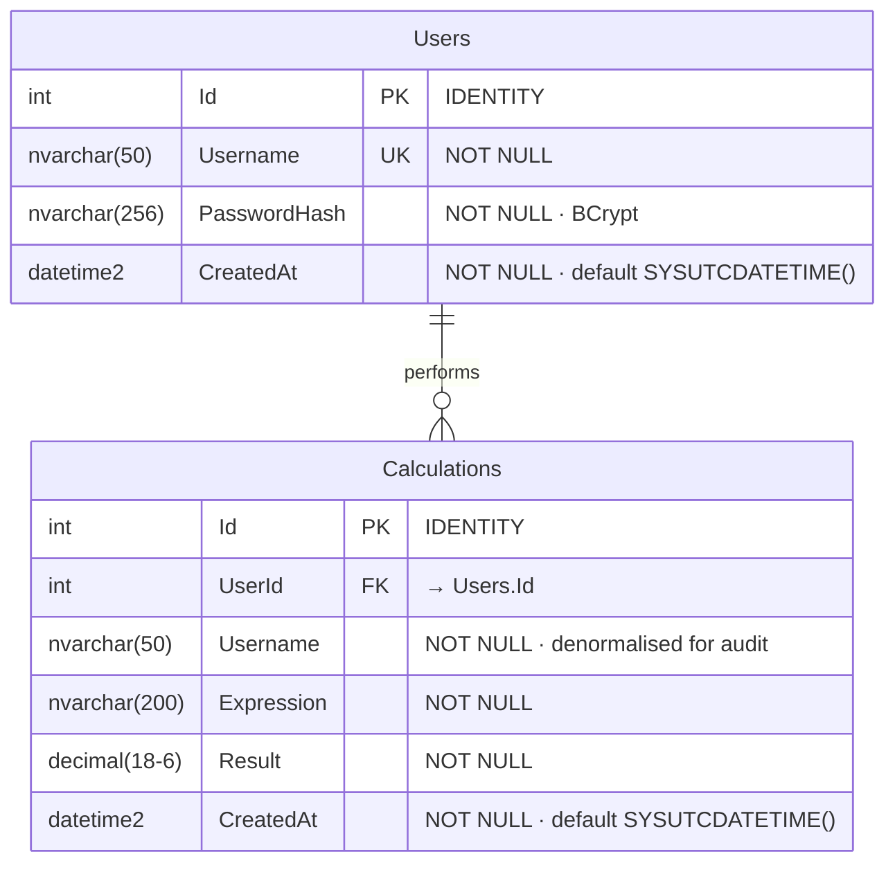

# Story 4.3: Users + Calculations tables (EF Core migration + raw SQL script)

Status: ready-for-dev

## Story

As **the team**,
I want **`User` and `Calculation` entities defined with data annotations and a single `OnModelCreating` for the bits annotations can't express, then the first migration applied to a clean database**,
so that **the schema matches PRD §8 and Story 4.4 can seed users into a live schema** — using the simplest EF Core idioms possible (PRD §11 C6: no `IEntityTypeConfiguration<T>` files, no DDD, no Repository).

## Acceptance Criteria

1. Two entity classes exist:
   - `backend/WebCalculator.Api/Data/User.cs`
   - `backend/WebCalculator.Api/Data/Calculation.cs`
   - Both use **data annotations** (`[Required]`, `[MaxLength]`) for what annotations can express.
   - **No separate `IEntityTypeConfiguration<T>` files.**
2. `AppDbContext` exposes `DbSet<User> Users` and `DbSet<Calculation> Calculations`, plus an `OnModelCreating` that adds: unique index on `Username`, `IX_Calculations_Username`, `decimal(18,6)` precision for `Result`, `SYSUTCDATETIME()` defaults for `CreatedAt`, and `OnDelete(Restrict)` on the FK.
3. The first migration `InitialCreate` is generated and applies cleanly via `dotnet ef database update`.
4. The applied schema matches PRD §8 (verified via `sqlcmd`).
5. A hand-written `sql/001_create_schema.sql` mirror exists at the repo root.
6. Rollback (`dotnet ef database update 0`) removes both tables and `__EFMigrationsHistory`.

## Tasks / Subtasks

- [ ] **Task 1 — Create entity classes** (AC: 1)
  - [ ] `backend/WebCalculator.Api/Data/User.cs` per **Dev Notes → Entities**.
  - [ ] `backend/WebCalculator.Api/Data/Calculation.cs` per **Dev Notes → Entities**.

- [ ] **Task 2 — Update `AppDbContext`** (AC: 2)
  - [ ] Edit `backend/WebCalculator.Api/Data/AppDbContext.cs` per **Dev Notes → `AppDbContext` content**.

- [ ] **Task 3 — Generate the migration** (AC: 3)
  - [ ] ```bash
    dotnet ef migrations add InitialCreate --project backend/WebCalculator.Api
    ```
  - [ ] Inspect the generated `Migrations/<timestamp>_InitialCreate.cs` — should `CreateTable("Users")` + `CreateTable("Calculations")` with the right columns + indexes + FK.

- [ ] **Task 4 — Apply to the dev DB** (AC: 3, 4)
  - [ ] ```bash
    dotnet ef database update --project backend/WebCalculator.Api
    ```
  - [ ] Verify with `sqlcmd -S "(localdb)\MSSQLLocalDB" -d WebCalculator -Q "SELECT name FROM sys.tables"` → returns `Users`, `Calculations`, `__EFMigrationsHistory`.
  - [ ] `EXEC sp_help 'Calculations'` → `Result` shows `decimal(18,6)`.
  - [ ] `EXEC sp_helpindex 'Calculations'` → includes `IX_Calculations_Username`.

- [ ] **Task 5 — Write the raw SQL mirror** (AC: 5)
  - [ ] Create `sql/001_create_schema.sql` at repo root per **Dev Notes → SQL mirror**.

- [ ] **Task 6 — Verify rollback** (AC: 6)
  - [ ] `dotnet ef database update 0 --project backend/WebCalculator.Api` → tables removed.
  - [ ] Re-apply: `dotnet ef database update --project backend/WebCalculator.Api` → tables back.

- [ ] **Task 7 — Open the PR**
  - [ ] Branch: `feature/4.3-users-calculations-tables`

## Dev Notes

### ER Diagram (inline)



> ⚠️ Mermaid quirk: write `decimal(18-6)` (with a dash) not `decimal(18,6)`; commas inside parens confuse the parser. The SQL type is still `DECIMAL(18,6)`.

**Index:** `IX_Calculations_Username` (non-clustered) — supports the History search-by-user filter (PRD FR4).

**Why denormalised `Username` on `Calculations`?** Single-table read for History (no join), and audit survives user deletion (PRD §11 C3).

**Why `DECIMAL(18,6)` for `Result`?** Avoids binary-rounding artefacts (`0.1 + 0.2`) that floats produce. Range easily covers anything `+ - * /` on inputs up to ~10¹².

### Entities (data annotations only)

`backend/WebCalculator.Api/Data/User.cs`:

```csharp
using System.ComponentModel.DataAnnotations;

namespace WebCalculator.Api.Data;

public class User
{
    public int Id { get; set; }

    [Required, MaxLength(50)]
    public string Username { get; set; } = "";

    [Required, MaxLength(256)]
    public string PasswordHash { get; set; } = "";

    public DateTime CreatedAt { get; set; }

    // Navigation
    public List<Calculation> Calculations { get; set; } = new();
}
```

`backend/WebCalculator.Api/Data/Calculation.cs`:

```csharp
using System.ComponentModel.DataAnnotations;

namespace WebCalculator.Api.Data;

public class Calculation
{
    public int Id { get; set; }

    public int UserId { get; set; }
    public User? User { get; set; }   // navigation; nullable so EF doesn't require eager hydration

    [Required, MaxLength(50)]
    public string Username { get; set; } = "";   // denormalised — see PRD §11 C3

    [Required, MaxLength(200)]
    public string Expression { get; set; } = "";

    public decimal Result { get; set; }

    public DateTime CreatedAt { get; set; }
}
```

### `AppDbContext` content (replaces the stub from Story 4.2)

`backend/WebCalculator.Api/Data/AppDbContext.cs`:

```csharp
using Microsoft.EntityFrameworkCore;

namespace WebCalculator.Api.Data;

public class AppDbContext : DbContext
{
    public AppDbContext(DbContextOptions<AppDbContext> options) : base(options) { }

    public DbSet<User> Users => Set<User>();
    public DbSet<Calculation> Calculations => Set<Calculation>();

    protected override void OnModelCreating(ModelBuilder mb)
    {
        // Users
        mb.Entity<User>().HasIndex(u => u.Username).IsUnique();
        mb.Entity<User>().Property(u => u.CreatedAt).HasDefaultValueSql("SYSUTCDATETIME()");

        // Calculations
        mb.Entity<Calculation>().HasIndex(c => c.Username).HasDatabaseName("IX_Calculations_Username");
        mb.Entity<Calculation>().Property(c => c.Result).HasColumnType("decimal(18,6)");
        mb.Entity<Calculation>().Property(c => c.CreatedAt).HasDefaultValueSql("SYSUTCDATETIME()");
        mb.Entity<Calculation>()
            .HasOne(c => c.User)
            .WithMany(u => u.Calculations)
            .HasForeignKey(c => c.UserId)
            .OnDelete(DeleteBehavior.Restrict);   // preserve audit if a user row is later removed
    }
}
```

That's it. ~15 lines of fluent API in **one place**. No separate `Configurations/` folder, no `ApplyConfigurationsFromAssembly`, no `IEntityTypeConfiguration<T>` files. Easy to read top-to-bottom (PRD §11 C6).

### SQL mirror

`sql/001_create_schema.sql`:

```sql
-- WebCalculator schema (mirrors EF Core migration InitialCreate).
-- Generated 2026-05-06.

IF OBJECT_ID('dbo.Calculations', 'U') IS NOT NULL DROP TABLE dbo.Calculations;
IF OBJECT_ID('dbo.Users',        'U') IS NOT NULL DROP TABLE dbo.Users;

CREATE TABLE dbo.Users (
    Id           INT           IDENTITY(1,1) NOT NULL,
    Username     NVARCHAR(50)                NOT NULL,
    PasswordHash NVARCHAR(256)               NOT NULL,
    CreatedAt    DATETIME2                   NOT NULL DEFAULT SYSUTCDATETIME(),
    CONSTRAINT PK_Users PRIMARY KEY CLUSTERED (Id)
);

CREATE UNIQUE INDEX IX_Users_Username ON dbo.Users (Username);

CREATE TABLE dbo.Calculations (
    Id          INT             IDENTITY(1,1) NOT NULL,
    UserId      INT                           NOT NULL,
    Username    NVARCHAR(50)                  NOT NULL,
    Expression  NVARCHAR(200)                 NOT NULL,
    Result      DECIMAL(18, 6)                NOT NULL,
    CreatedAt   DATETIME2                     NOT NULL DEFAULT SYSUTCDATETIME(),
    CONSTRAINT PK_Calculations          PRIMARY KEY CLUSTERED (Id),
    CONSTRAINT FK_Calculations_Users    FOREIGN KEY (UserId) REFERENCES dbo.Users (Id) ON DELETE NO ACTION
);

CREATE INDEX IX_Calculations_Username ON dbo.Calculations (Username);
CREATE INDEX IX_Calculations_UserId   ON dbo.Calculations (UserId);
```

> EF auto-creates `IX_Calculations_UserId` because of the FK. We document it explicitly so the SQL truly mirrors the migration.

### Why `OnDelete(Restrict)` (= SQL `NO ACTION`)

The denormalised `Username` on `Calculations` (PRD §11 C3) preserves the audit trail. We must NOT cascade-delete calculations when a user row is removed.

### Migration commands cheat sheet

```bash
# Create the next migration
dotnet ef migrations add <Name> --project backend/WebCalculator.Api

# Apply the latest migration
dotnet ef database update --project backend/WebCalculator.Api

# Roll back to a specific migration (use 0 to remove all)
dotnet ef database update <MigrationName-or-0> --project backend/WebCalculator.Api
```

(With a single-project setup, no `--startup-project` flag is needed.)

### Out of scope

- Seeding users (Story 4.4).
- Repository / Unit-of-Work pattern (PRD §11 C6).
- `IEntityTypeConfiguration` files (PRD §11 C6).
- Soft-delete, audit triggers, temporal tables — not in PRD §8.
- Test-DB strategy (Story 7.1).

### Project Structure Notes

- **NEW:** `backend/WebCalculator.Api/Data/User.cs`
- **NEW:** `backend/WebCalculator.Api/Data/Calculation.cs`
- **NEW:** `backend/WebCalculator.Api/Migrations/<timestamp>_InitialCreate.cs` (+ designer & snapshot)
- **NEW:** `sql/001_create_schema.sql`
- **MODIFY:** `backend/WebCalculator.Api/Data/AppDbContext.cs` (add `DbSet<>`s + `OnModelCreating`)

### References

- [Source: PRD §8 Data Model, §11 C3, C6](../planning-artifacts/prd.md)
- [Source: epics.md Story 4.3](../planning-artifacts/epics.md)
- EF Core data annotations: https://learn.microsoft.com/en-us/ef/core/modeling/entity-properties
- EF Core OnModelCreating / fluent API: https://learn.microsoft.com/en-us/ef/core/modeling/

## Dev Agent Record

### Agent Model Used

### Debug Log References

### Completion Notes List

### File List
